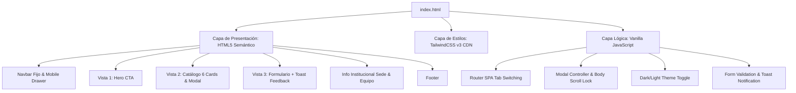

# Arquitectura del Sistema: Patitas Seguras - Refugio & Rescate

## 1. Visión General de la Arquitectura
El proyecto está concebido bajo una arquitectura **Single Page Application (SPA) client-side pura**, implementada en un único archivo ejecutable [`index.html`](file:///c:/Users/G/Documents/itec/segundo/prog2/seminario_antigravity/index.html) sin empaquetadores ni dependencias de servidor.

---

## 2. Stack Tecnológico

| Capa / Rol | Tecnología | Origen / Distribución | Justificación Técnica |
| :--- | :--- | :--- | :--- |
| **Estructura** | HTML5 Semántico | Estándar W3C | Estructura accesible (`<header>`, `<main>`, `<article>`, `<section>`, `<nav>`, `<button>`). |
| **Estilos & Diseño** | TailwindCSS v3 | CDN Oficial (``) | Maquetado utility-first rápido, sistema de diseño consistente y soporte nativo de `dark:`. |
| **Tipografía** | Google Fonts | CDN (`Plus Jakarta Sans` & `Noto Sans`) | Jerarquía visual profesional y óptima legibilidad en pantallas. |
| **Interactividad** | JavaScript Vanilla (ES6+) | Nativo del navegador | Máximo rendimiento, cero dependencias, didáctico y mantenible. |

---

## 3. Mapa de Módulos de la SPA

1. **Header & Navigation Module**:
   - Barra fija superior con logo, enlaces rápidos y botón selector de tema (Dark/Light).
   - Menú Drawer lateral desplegable para pantallas móviles (área de toque min 44px).
2. **Hero Presentation Module (Vista 1)**:
   - Encabezado de bienvenida con propuesta de valor, llamado a la acción principal (CTA) para explorar animales o reportar rescates.
3. **Catalog & Card Grid Module (Vista 2)**:
   - Grilla responsive (1 columna móvil, 3 desktop) con 6 tarjetas completas de animales en tránsito.
   - Componente Modal emergente dinámico que muestra la ficha técnica completa al hacer clic en `"Ver ficha"`.
4. **Form & Interactive Feedback Module (Vista 3)**:
   - Formulario de contacto, solicitud de adopción, tránsito o rescate.
   - Componente flotante **Toast verde** de confirmación al procesar la solicitud.
5. **Institutional & Location Module**:
   - Bloque informativo ubicado debajo del formulario: equipo, misión, días/horarios de visita, sede física y canales de donación.
6. **Footer Module**:
   - Vías de contacto de urgencia, redes sociales y copyright legal.

---

## 4. Tecnologías Prohibidas (Límites Estrictos)

Queda estrictamente prohibido incorporar al proyecto:
- ❌ **Frameworks SPA pesados**: CERO React, Vue, Angular, Svelte o similares.
- ❌ **Entornos y Backends de Servidor**: CERO Node.js, Express, Python (Django/Flask), PHP o Ruby.
- ❌ **Bases de Datos**: CERO MySQL, PostgreSQL, MongoDB, Firebase o Supabase.
- ❌ **Hojas de Estilo Monolíticas / Estilos en Línea**: CERO atributos `style="..."` caóticos.
- ❌ **Bundlers o Herramientas de Compilación**: CERO Vite, Webpack, Parcel o Gulp (todo se ejecuta directamente en el navegador).
